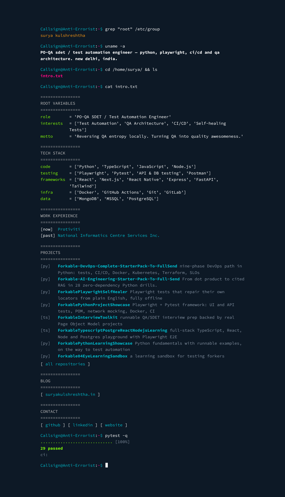

# suryakulshreshtha.github.io

[](https://github.com/suryakulshreshtha/suryakulshreshtha.github.io/actions/workflows/ci.yml)
[](https://github.com/suryakulshreshtha/suryakulshreshtha.github.io/actions/workflows/links.yml)

> A portfolio that boots like a terminal and ends in a `pytest` run that is actually real.

**Live → [suryakulshreshtha.github.io](https://suryakulshreshtha.github.io)**



## Stack

One `index.html` · vanilla JS · no build step · tested with **pytest + Playwright + axe-core** on GitHub Actions.

The whole page is plain HTML, so crawlers, link previews and no-JS browsers get everything. The script only *replays* it as typing.

## Run

```bash
python -m http.server 8000      # → http://localhost:8000
```

## Test

```bash
pip install -r requirements-dev.txt
python -m playwright install chromium

pytest                          # the suite the terminal reports on (offline, ~20 s)
pytest -m external              # every outside link, for real
SITE_URL=https://suryakulshreshtha.github.io pytest   # same suite against production
```

| File | Proves |
| --- | --- |
| `test_animation.py` | boots clean (no console errors), types, skips on any key or button, honours reduced motion, hands crawlers the finished page, no sideways scroll on a phone, follows light/dark |
| `test_crawlable.py` | the served HTML holds the full profile; JS off shows everything; JS adds nothing a crawler would miss; one `h1`, six `h2`s |
| `test_meta.py` | title, description, canonical, Open Graph, Twitter card, 1200×630 preview image, JSON-LD `Person`, robots + sitemap |
| `test_a11y.py` | zero axe-core violations (WCAG 2.2 AA + best practice) in both themes; visible keyboard focus |
| `test_links.py` | `target=_blank` is `noopener`; every own-site reference resolves; `-m external` checks each outside link |
| `test_honesty.py` | **the `N passed` and the dots on the page equal the number of tests in this suite**, and the badge points at this workflow |

Add a test without updating the page and CI goes red. That's the point.

## Layout

```
index.html               the site: content, styles, ~120 lines of animation
og.png                   link-preview card (generated)
robots.txt, sitemap.xml  for search engines
tests/                   pytest + Playwright suite (pages.py = page object)
scripts/capture.py       regenerates og.png and docs/screenshot.png
scripts/og-card.html     source of the preview card
.github/workflows/       ci.yml (every push) · links.yml (weekly)
docs/GUIDE.md            setup, editing, colours, troubleshooting
```

Editing anything? Start with **[docs/GUIDE.md](docs/GUIDE.md)**.
